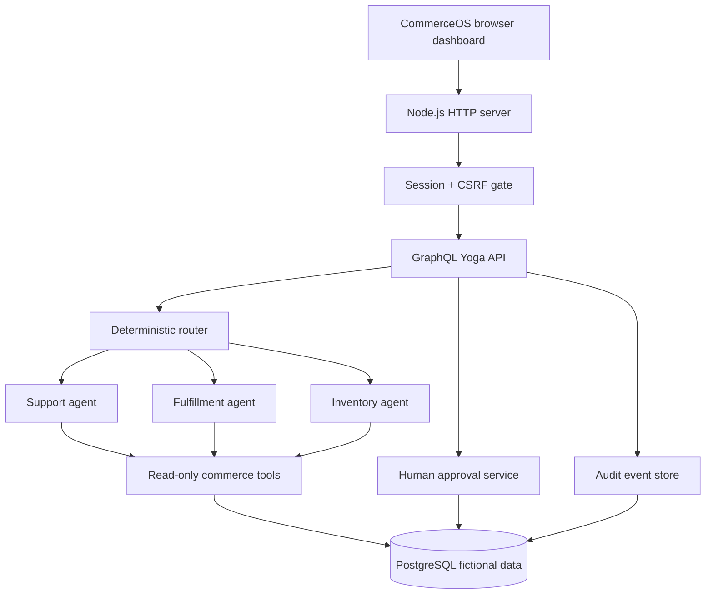

# CommerceOS
### Human-supervised AI agents for e-commerce operations

CommerceOS is a **portfolio prototype** of an AI-assisted operations workspace. Three specialized agents answer questions about fictional orders, inventory and fulfillment. A deterministic controller restricts each agent to approved read-only tools; a separate human approval workflow records replenishment decisions in PostgreSQL.

Built with **TypeScript · Node.js · GraphQL Yoga · PostgreSQL · OpenAI Responses API · HTML/CSS/JavaScript**.

> **Demo scope:** fictional data only. No real customers, shipments, refunds, purchases or external supplier integrations. Keep the Codespaces port private.

## What you can demonstrate

| Capability | How it works |
| --- | --- |
| Operations dashboard | Responsive overview, inventory, order status, approvals, and agent workspace |
| Three specialized agents | Customer Support, Fulfillment, and Inventory |
| Constrained tool execution | Per-role read-only tool allowlists, validated arguments, bounded calls and turns |
| Human approval | Low-stock proposal → pending review → approve/reject; no purchase order is sent |
| Access controls | Single-demo-admin password, server-side session, CSRF token, protected GraphQL |
| Accountability | PostgreSQL approval audit trail and privacy-conscious agent-run metadata |
| Offline evaluation | 14 scripted routing/tool/safety scenarios without API calls |
| Live evaluation | Three opt-in fictional-model scenarios with token and latency reporting |

## System architecture



The model can **request** a tool, but Node.js checks the tool name and arguments before reading data. Each role sees only its approved tool. The approval system uses a deterministic stock rule and is *not* an AI purchasing agent.

Read the detailed [architecture and design tradeoffs](docs/ARCHITECTURE.md).

## Run in GitHub Codespaces

Open the branch being reviewed (`feat/phase8-portfolio-release`, or `main` after integration) in GitHub Codespaces, then:

```bash
npm install
cp .env.example .env   # only if you don't already have .env
docker compose up -d db
npm test
npm run typecheck
npm run build
npm run dev
```

**Required:** Set `DASHBOARD_ADMIN_PASSWORD` as a **Codespaces repository secret** (unique, at least 12 characters) and restart the Codespace before `npm run dev`. Keep secrets out of Git and chat. An `OPENAI_API_KEY` Codespaces secret is optional and is only needed for billable live AI runs. For detailed setup and troubleshooting, see [the demo guide](docs/DEMO.md).

In Codespaces **Ports**, open port `4000` (visibility **Private**) and visit `/dashboard` on its forwarded URL. Sign in with your demo-admin password. The GraphQL endpoint is `/graphql` and requires an authenticated session plus an `x-csrf-token` header on POST requests.

## Demo flow in 90 seconds

1. **Overview:** Show order, processing-order, low-stock and pending-approval cards.
2. **Inventory:** Cotton T-shirt (`SHIRT-002`) is seeded with 8 units; click **Create proposal**. The illustrative target of 30 yields a recommendation of 22.
3. **Approvals:** Review and approve/reject the proposal. Refresh to show PostgreSQL persistence. Inventory remains unchanged.
4. **Activity log:** Show the `demo-admin` approval event and timestamp.
5. **AI Workspace (optional/billable):** Ask Support “What is the status of order 1042?” The fictional order is shipped. Show the single read-only tool call and answer.
6. **Sign out:** Show that the protected dashboard requires login.

A rehearsal checklist and interview Q&A are in [docs/DEMO.md](docs/DEMO.md).

## Verification evidence

| Check | Recorded result | Interpretation |
| --- | --- | --- |
| Offline scripted evaluations | **14/14 passed**, Oct 27, 2026 | Deterministic routing, tool outputs and safety checks—not real LLM reasoning |
| Live OpenAI evaluation (`gpt-4.1-mini`) | **3/3 cases passed**, Oct 27, 2026 | Three fixed, fictional fact checks; does not imply broad production accuracy |
| Live model requests | **6 requests**, 881 input tokens, 148 output tokens | Real token usage, not a cost estimate |
| Live latency | **2.07s average**, 2.66s p95 | End-to-end latency over those three scenarios |
| Phase 6 automated suite | **30/30 tests passed** | User-verified in Codespaces |
| Phase 7 tests, typecheck, build | **Reported passing by project owner** | Exact final test count not independently captured here |

Run `npm run eval` to reproduce the **offline** scripted suite. The command does not call OpenAI. For a billable live evaluation, explicitly use `npm run eval:live -- --confirm-live`. That runner limits attempted requests to 9 per run; it does **not** impose a hard dollar limit. Optional token-price estimates require confirmed current rates.

## Engineering boundaries

- **No real-world actions:** The AI tools can only read order/inventory metadata. Human approval records a decision; it never purchases stock.
- **Defense in depth:** The model receives a limited tool schema, while the backend independently checks tool allowlists, input types and bounds.
- **Privacy:** Agent logs record role, outcome, tool count and latency, not prompts, response bodies or secrets.
- **Access:** Phase 7 uses one demo-admin account, not multi-user authorization. Login throttling and session storage are in process.
- **Limitations:** No real integrations, tenant isolation, MFA, password reset, production monitoring or distributed rate limits. A `PROCESSING` order is not automatically considered delayed.

This repository is an **engineering demonstration**, not a deployed e-commerce service. Details in [docs/ARCHITECTURE.md](docs/ARCHITECTURE.md).

## Repository guide

- `src/agent/` — specialized agents, router and OpenAI Responses API adapter
- `src/evaluation/` — offline and opt-in live evaluation engines
- `src/approvals.ts`, `src/approval-db.ts` — human approval lifecycle and persistence
- `src/session-auth.ts`, `src/secure-server.ts` — session and HTTP access controls
- `src/schema.ts` — GraphQL schema and resolvers
- `dashboard/` — framework-free operations UI
- `tests/` — deterministic unit and API tests
- `docs/` — architecture, demo and portfolio guidance

## License and attribution

Created as a personal educational portfolio project. Do not use as-is for production data or real order management.
