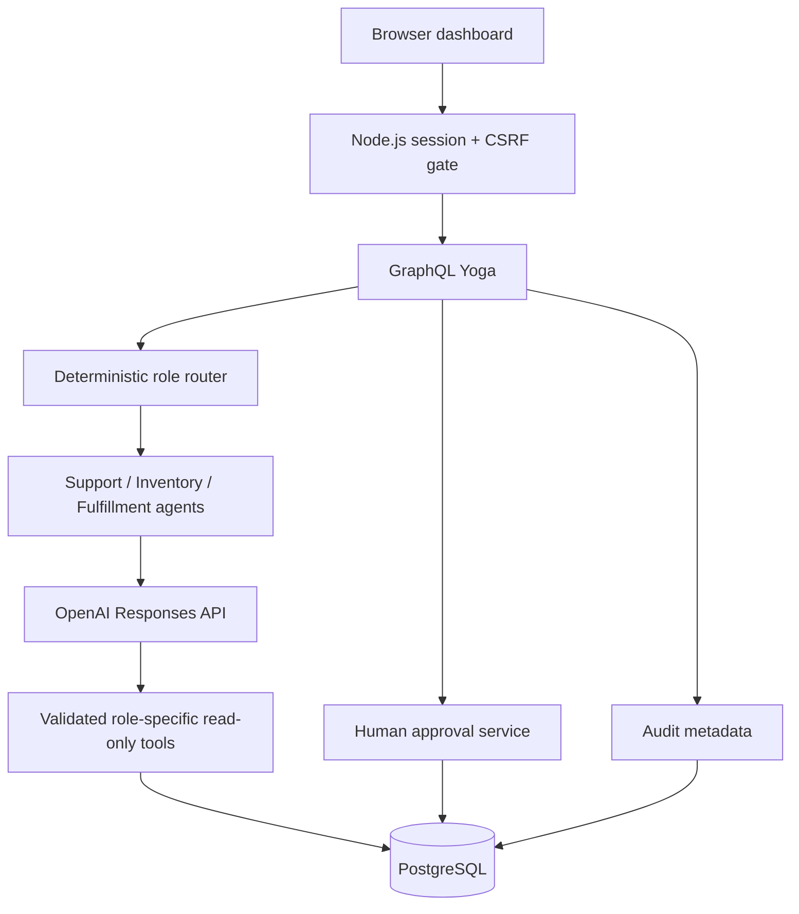
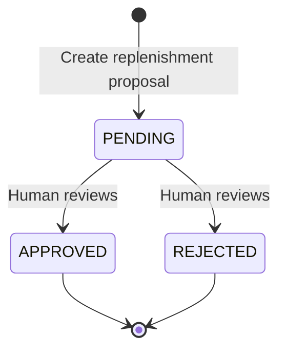

# CommerceOS architecture and tradeoffs

CommerceOS is a prototype over **fictional** commerce data. It combines a responsive dashboard, an authenticated GraphQL backend, three read-only agents, and a separate human approval system.

## Runtime request flow

Each agent can request only the tool authorized for its role:

| Agent | Allowed tool | Returned data |
| --- | --- | --- |
| SUPPORT | `get_order_status` | Order ID and status |
| INVENTORY | `get_low_stock` | SKU, product name and quantity |
| FULFILLMENT | `get_processing_orders` | Processing order IDs and statuses |

The backend checks tool names and arguments independently of the model's tool schema. It also bounds questions to 1–1,000 characters, tool calls to 2, and model turns to 4.

## Human approval state machine

The replenishment proposal is **deterministic**, not a model buying stock. Only items with 10 or fewer units qualify. The illustrative target is 30 units. PostgreSQL enforces at most one pending proposal per SKU. An atomic transaction changes a pending status and inserts an audit event. Approved proposals do **not** modify inventory or contact suppliers.

## Authentication and audit

Phase 7 protects the private Codespaces app using a single environment-secret admin password, 8-hour in-process random sessions, HttpOnly/SameSite cookies, CSRF tokens on GraphQL POSTs, and failed-login throttling. Audit rows track category, actor (`demo-admin`), action, subject, outcome, and limited agent timing/tool-call metadata; they exclude prompts, answer bodies, customer emails and API keys.

This is **not production authentication**: no verified individuals, MFA, RBAC, tenant segregation, shared sessions or distributed rate limiting. Codespaces port 4000 must remain Private.

## Design tradeoffs

| Choice | Benefit | Production improvement |
| --- | --- | --- |
| Deterministic router | Auditable routing | Confidence-aware classification and fallback |
| Read-only tools | Limits impact | Connector-specific authorization and tenancy |
| Single demo password | Easy private demo | Managed identity, MFA, verified reviewers |
| PostgreSQL init at startup | Easy Codespaces setup | Versioned migrations |
| Fixed evaluation scenarios | Repeatable regression checks | Diverse adversarial eval datasets and confidence intervals |
| Approval only records status | Human retains control | Idempotent, verified external execution flow |

## Evaluation limitations

- Offline scripted evaluation: **14/14 passing** cases, measuring local routing, tool results and guards.
- One opt-in live model run: **3/3 fixed fictional fact checks**, **6 API requests**, **881 input** and **148 output tokens**, **2.07s average** end-to-end latency.
- Neither result establishes general production accuracy. The 0.1ms offline harness timing is **not** real model latency.
